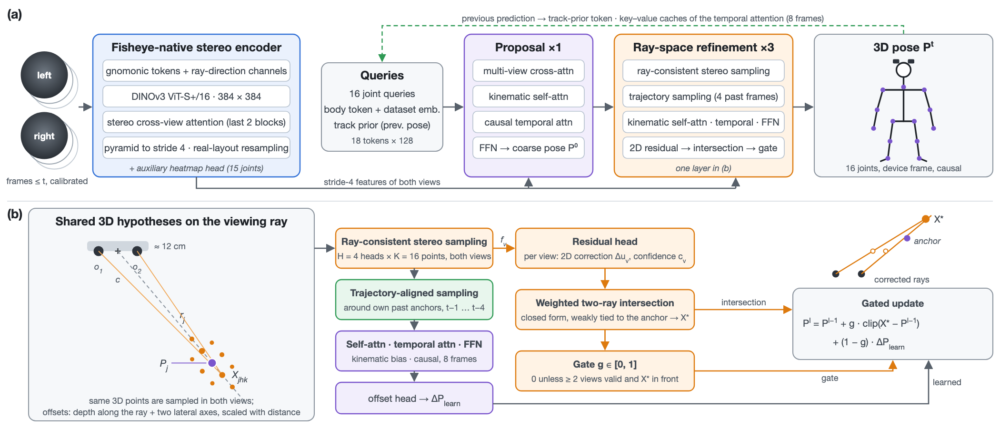

<p align="center">
  
</p>

<h1 align="center">EgoRayFormer</h1>

<p align="center"><a href="README.md">English</a> | 中文</p>

<p align="center"><b>EgoRayFormer: Ray-Space Stereo Refinement for Egocentric 3D Human Pose Estimation</b><br>面向第一视角 3D 人体姿态估计的射线空间双目细化</p>

<p align="center">
  <a href="https://arxiv.org/abs/2610.26641"></a>
  <a href="LICENSE"></a>
</p>

<p align="center">Haozhe Wang, Songyuan Wu, Jihai Xu, Jie Zhao · 博登智能</p>

本仓库是 [EgoRayFormer](https://arxiv.org/abs/2610.26641) 的官方实现。EgoRayFormer 是一个面向头戴式双目鱼眼相机的因果
3D 人体姿态估计器：解码器为每个关节在其视线射线上及周围生成共享的 3D 假设点，并投影到左右两幅图像中采样特征；
几何分支修正投影得到的关节位置并求两条射线的交点，再由学习得到的门控把这一几何估计与网络学习的姿态更新加权融合。



## 结果

设备相对（device-relative）协议，官方测试集，单位 mm，三个随机种子的均值 ± 标准差（论文表 1）。编码器为 DINOv3
ViT-S+/16，输入 384 × 384；每条序列以一个因果流按 FP32 推理。

| 训练数据 | 测试集 | MPJPE | PA-MPJPE |
|---|---|---|---|
| UnrealEgo2 | UnrealEgo2 | 17.64 ± 0.12 | 16.86 ± 0.08 |
| UnrealEgo-RW | UnrealEgo-RW | 49.55 ± 0.40 | 40.59 ± 0.30 |
| UnrealEgo2 → UnrealEgo-RW | UnrealEgo-RW | 47.57 ± 0.34 | 37.21 ± 0.46 |

与其他方法的比较见论文。

## 安装

测试环境：Python 3.10、PyTorch 2.4.0（CUDA 12.1）、PyTorch Lightning 2.4.0、timm 1.0.29、NumPy 1.26，NVIDIA H200
GPU。不需要编译任何 CUDA 算子。

```bash
git clone https://github.com/BodenAI/EgoRayFormer.git
cd EgoRayFormer
conda create -n egorayformer python=3.10 -y
conda activate egorayformer
pip install torch==2.4.0 torchvision==0.19.0 --index-url https://download.pytorch.org/whl/cu121
pip install -e .
```

所有命令都在仓库根目录下执行。`run.py` 和各脚本会把仓库根目录加入 `sys.path`，因此 editable 安装不是必须的。

**预训练主干。**
* ResNet-18：torchvision 的 ImageNet 权重，首次使用时自动下载。
* DINOv3 ViT-S+/16：timm `vit_small_plus_patch16_dinov3.lvd1689m`。该权重在 Hugging Face 上需要授权：接受 DINOv3
  许可后设置 `HF_TOKEN`；或者把 `<timm 模型名>.safetensors` 放到一个目录中，并用 `EGORAYFORMER_TIMM_WEIGHTS_DIR`
  指向该目录。
* 在没有 stage-1 checkpoint 的情况下，如果请求的预训练权重加载失败，训练会直接停止，而不是改用其他权重继续；
  设置 `EGORAYFORMER_ALLOW_WEIGHT_FALLBACK=1` 可允许回退。

## 预训练模型

表 1 的模型（seed 42；结果表报告的是三个 seed 的均值）即将发布，文件中保存的是评测所用的 EMA 权重。

| 模型 | 训练数据 | 测试集 | 文件 | 下载 |
|---|---|---|---|---|
| EgoRayFormer（ViT-S+/16，384²） | UnrealEgo2 | UnrealEgo2 | `egorayformer_ue2.ckpt` | 即将发布 |
| EgoRayFormer（ViT-S+/16，384²） | UnrealEgo-RW | UnrealEgo-RW | `egorayformer_rw.ckpt` | 即将发布 |
| EgoRayFormer（ViT-S+/16，384²） | UnrealEgo2 → UnrealEgo-RW | UnrealEgo-RW | `egorayformer_ue2_to_rw.ckpt` | 即将发布 |

SHA-256：

```
f4a0028421d3b9a1d8bb45fe3d336e072d8036a59afc4841fb03c5d7ce9c5100  egorayformer_ue2.ckpt
5b4612438b6204bab198f9e9d1cc7e696cd919052bc48c5cd084676e932f4c08  egorayformer_rw.ckpt
dfeb9c2867e14f4df97cda35f8fbffa37ba34f003e5a3b4133753a73ce12856e  egorayformer_ue2_to_rw.ckpt
```

每个模型都有一个包含全部设置的配置文件（`configs/egorayformer_ue2.yaml`、`egorayformer_rw.yaml`、
`egorayformer_ue2_to_rw.yaml`），`configs/eval.yaml` 是论文的评测设置（FP32，每条序列作为一个因果流）。在验证集上评测：

```bash
python run.py validate --config configs/egorayformer_rw.yaml --config configs/eval.yaml \
  --model.model.encoder.pretrained false --data.root /data/unrealego/processed --ckpt_path egorayformer_rw.ckpt
```

另外两个模型把 `egorayformer_rw` 换成 `egorayformer_ue2` 或 `egorayformer_ue2_to_rw`；评测测试集时，用相同参数运行
`EGORAYFORMER_ALLOW_TEST=1 python run.py test`。`--model.model.encoder.pretrained false` 表示不下载 DINOv3 预训练权重
（权重来自 checkpoint）。

## 数据

实验使用 [UnrealEgo2 和 UnrealEgo-RW](https://unrealego.mpi-inf.mpg.de/)，使用条款以数据集作者的规定为准。数据准备脚本
会下载官方文件，转换为 `egorayformer/data/records.py` 定义的统一记录格式，并删除原始数据：

```bash
export DATA_ROOT=/path/to/unrealego                 # 原始下载与处理后记录的位置（默认 /data/unrealego）
bash scripts/fetch_unrealego_meta.sh                # 官方划分文件与相机标定（很小）
bash scripts/stage_unrealego_rw.sh                  # UnrealEgo-RW：原始约 180 GB -> 512^2 记录 + 逐采集场次的 rig
bash scripts/stage_unrealego2_stream.sh train_val   # UnrealEgo2：原始约 3 TB，逐序列处理 -> 384^2 记录
bash scripts/stage_unrealego2_stream.sh test
```

记录写入 `$DATA_ROOT/processed/<dataset>/<split>/`。UnrealEgo-RW 每个采集场次的 rig 只用训练集标注拟合。数据准备脚本
需要 Linux 以及 `curl`、`unzip`、`tar`、`flock`，其他选项通过环境变量设置，说明见各脚本开头。如需代理，请设置
`http_proxy` / `https_proxy`。

## 训练

表 1 的三个模型各有一个配置文件（`configs/egorayformer_*.yaml`）；其他实验由多个配置从左到右组合，后面的文件覆盖
前面同名的键。每个模型分两个阶段训练：

1. 编码器在 256 × 256 上做 2D 热图预训练（`configs/stage_heatmap.yaml`）；
2. 从 stage-1 的最后一个 checkpoint 初始化，进行端到端训练。

`scripts/run_baselines.sh` 负责执行这两个阶段：为每次训练命名，把日志和 checkpoint 写到 `work_dirs/<run>/`，并记录
训练是否完成以及验证集最优的 checkpoint（`scripts/ckpt_select.py`）。下面的命令复现论文中的各个配置。每个配置都用
随机种子 42、1、2 各训练一次：在 `EXTRA` 中追加 `--seed_everything <seed>`，并修改 `RUN_SUFFIX`。除 UnrealEgo-RW 上
ResNet-18 的热图阶段（4 卡 × 64 clips；下面的命令用 1 卡 × 256）外，所有训练均为单卡。

```bash
export ROOT=$DATA_ROOT/processed                    # run_baselines.sh 会检查该目录
D="--data.root $ROOT"
H="--data.batch_size 256 --trainer.strategy auto $D"                                   # stage 1
T="--trainer.strategy auto --data.batch_size 16 --data.clips_per_epoch_scale 2 $D"     # stage 2

# Stage 1，DINOv3 ViT-S+/16 编码器
HM_NAME=hm_sfvit_s_rw  TRAINSET=rw  GPUS=0 HM_EXTRA="--config configs/enc_sfvit_s.yaml $H" bash scripts/run_baselines.sh heatmap
HM_NAME=hm_sfvit_s_ue2 TRAINSET=ue2 GPUS=0 HM_EXTRA="--config configs/enc_sfvit_s.yaml $H" bash scripts/run_baselines.sh heatmap

# 表 1：在 UnrealEgo-RW 上训练 -> run egorayformer_device_rw_main
HM_NAME=hm_sfvit_s_rw TRAINSET=rw PROTOS=device GPUS=0 RUN_SUFFIX=_main \
  EXTRA="--config configs/egorayformer_rw.yaml $D" bash scripts/run_baselines.sh egorayformer
# 表 1：在 UnrealEgo2 上训练（3 个 epoch）-> run egorayformer_device_ue2_main
HM_NAME=hm_sfvit_s_ue2 TRAINSET=ue2 PROTOS=device GPUS=0 RUN_SUFFIX=_main \
  EXTRA="--config configs/egorayformer_ue2.yaml $D" bash scripts/run_baselines.sh egorayformer
# 表 1：先 UnrealEgo2、再 UnrealEgo-RW（加载同一种子 UnrealEgo2 模型的最优 checkpoint 权重）
INIT_FROM_RUN=egorayformer_device_ue2_main TRAINSET=rw PROTOS=device GPUS=0 RUN_SUFFIX=_from_ue2 \
  EXTRA="--config configs/egorayformer_ue2_to_rw.yaml $D" bash scripts/run_baselines.sh egorayformer
```

不使用 launcher 时，RW 模型的 stage 2 只需一条命令（日志和 checkpoint 写到 `work_dirs/egorayformer_rw/`）：

```bash
python run.py fit --config configs/egorayformer_rw.yaml --data.root $ROOT \
  --model.encoder_pretrained "$(python scripts/ckpt_select.py last hm_sfvit_s_rw)"
```

论文中的其他实验：

```bash
# 表 2：ResNet-18 + FPN，输入 256^2（stage 1 使用默认编码器）
HM_NAME=hm_r18_rw  TRAINSET=rw  GPUS=0 HM_EXTRA="$H" bash scripts/run_baselines.sh heatmap
HM_NAME=hm_r18_ue2 TRAINSET=ue2 GPUS=0 HM_EXTRA="$H" bash scripts/run_baselines.sh heatmap
R="--config configs/ablations/no_p4.yaml --config configs/invalid_view_mask.yaml"
HM_NAME=hm_r18_rw  TRAINSET=rw  PROTOS=device GPUS=0 RUN_SUFFIX=_r18 EXTRA="$R $T" bash scripts/run_baselines.sh egorayformer
HM_NAME=hm_r18_ue2 TRAINSET=ue2 PROTOS=device GPUS=0 RUN_SUFFIX=_r18 \
  EXTRA="$R --config configs/fov_circle.yaml --config configs/sched_e3.yaml $T" bash scripts/run_baselines.sh egorayformer

# 表 2：TSR-like，我们按 TSR-Ego 论文描述实现的解码器（并非复现）
L="--config configs/tsr_layer_order.yaml --trainer.strategy auto --data.clips_per_epoch_scale 2 $D"
HM_NAME=hm_r18_rw  TRAINSET=rw  PROTOS=device GPUS=0 RUN_SUFFIX=_tsr EXTRA="$L" bash scripts/run_baselines.sh tsr
HM_NAME=hm_r18_ue2 TRAINSET=ue2 PROTOS=device GPUS=0 RUN_SUFFIX=_tsr EXTRA="$L" bash scripts/run_baselines.sh tsr
# 表 4（协议差异）：同一 TSR-like 模型，目标相对于真值髋部中点，训练和推理时该点也作为投影原点（oracle root）
HM_NAME=hm_r18_rw  TRAINSET=rw  PROTOS=root   GPUS=0 RUN_SUFFIX=_tsr EXTRA="$L" bash scripts/run_baselines.sh tsr

# 表 3：UnrealEgo-RW 上的消融（验证集）
S="--config configs/ablations/no_p4.yaml --config configs/enc_sfvit_s.yaml --config configs/invalid_view_mask.yaml"
for abl in no_geo no_p3 no_track_prior; do        # 几何分支、轨迹对齐采样、轨迹先验
  HM_NAME=hm_sfvit_s_rw TRAINSET=rw PROTOS=device GPUS=0 RUN_SUFFIX=_$abl \
    EXTRA="$S --config configs/res_384.yaml --config configs/ablations/$abl.yaml $T" bash scripts/run_baselines.sh egorayformer
done
# 256^2 输入：同上但不加 configs/res_384.yaml（完整模型与 no_geo）。
# 普通 DINOv3 编码器：stage 1 和 stage 2 都用 configs/enc_dinov3_plain_s.yaml 替换 configs/enc_sfvit_s.yaml。
```

表 2 中的 `EPF-device` 使用官方 [EgoPoseFormer](https://github.com/ChenhongyiYang/egoposeformer) 代码加 UnrealEgo-RW
适配训练，适配代码不在本仓库中。

## 评测

模型选择只使用验证集。`python scripts/ckpt_select.py best <run>` 返回已完成训练的验证集最优 checkpoint，
`scripts/retest_runs.py` 用该次训练保存的配置对其进行评测。论文报告的是 FP32、每条序列一个因果流的评测结果：

```bash
python scripts/retest_runs.py --from_config --runs egorayformer_device_rw_main --dataset unrealego_rw \
  --mode validate --gpus 0 --out work_dirs/eval --seq_dump \
  --extra "--model.eval_precision fp32 --data.eval_clip_len 0"
```

指标写入 `work_dirs/eval/<run>/lightning_logs/version_*/metrics.csv`。评测 UnrealEgo2 模型时使用
`--dataset unrealego2`。`--seq_dump` 输出逐序列的误差和，`--diag_dump` 输出误差与门控分析所用的最后一层候选。

测试集只用于评测已冻结的配置：`run.py test` 需要设置 `EGORAYFORMER_ALLOW_TEST=1` 才会运行，`retest_runs.py --mode test`
需要 `--allow_test`。

## 仓库结构

```
run.py                 LightningCLI 入口（fit / validate / test / predict）
egorayformer/
  data/                记录格式、clip 数据集与评测协议、鱼眼相机模型、热图、骨架定义
  models/              编码器（ResNet-18 + FPN、DINOv3 ConvNeXt、鱼眼原生双目 ViT）、注意力与射线几何层、EgoRayFormer
  training/            LightningModule、损失函数、类型化配置
  eval/                指标（MPJPE、PA-MPJPE、PCK、AUC、MPJVE、分层统计）、输入审查、基准格式导出
configs/               每个发布模型一个配置（egorayformer_*.yaml）、eval.yaml、其他实验用的可组合配置
scripts/               数据准备、训练启动、checkpoint 选择、评测
assets/                架构图
docs/logo/             logo
```

代码中还有一些用于其他实验的开关，默认关闭；每个配置文件开头的注释说明了它修改的内容。

## 引用

```bibtex
@article{wang2026egorayformer,
  title   = {{EgoRayFormer}: Ray-Space Stereo Refinement for Egocentric {3D} Human Pose Estimation},
  author  = {Wang, Haozhe and Wu, Songyuan and Xu, Jihai and Zhao, Jie},
  journal = {arXiv preprint arXiv:2610.26641},
  year    = {2026}
}
```

## 许可证与致谢

代码以 [Apache License 2.0](LICENSE) 发布。部分代码改编自其他 Apache-2.0 项目，并在文件开头注明了来源：
* [EgoPoseFormer](https://github.com/ChenhongyiYang/egoposeformer)：`models/backbones/r18_fpn.py`、
  `models/backbones/fpn.py`、`models/layers/deform_stereo_attn.py`、`models/layers/ray_stereo_attn.py`（模块约定）、
  `data/camera.py`、`eval/metrics.py`（`batch_procrustes`）；
* [mmcv](https://github.com/open-mmlab/mmcv)：`models/layers/deform_stereo_attn.py` 的采样核心；
* [EgoRear](https://github.com/hiroyasuakada/EgoRear)：`data/camera.py`。

数据集与 DINOv3 权重遵循各自的许可证，不包含在本仓库中。

---
## 联系我们

<p align="center">
  
</p>

<p align="center">
  <a href="https://bodenai.com">bodenai.com</a>（中文）&nbsp;·&nbsp;
  <a href="https://www.boden.ai">boden.ai</a>（English）
</p>

<p align="center">
  <a href="mailto:company@bodenai.com">company@bodenai.com</a>&nbsp;·&nbsp;
  <a href="mailto:EAI@bodenai.com">EAI@bodenai.com</a>
</p>
